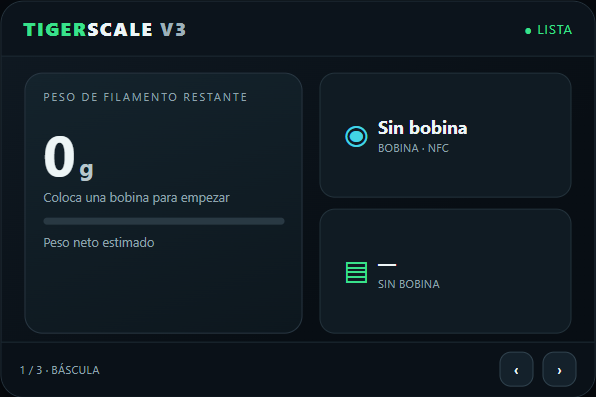
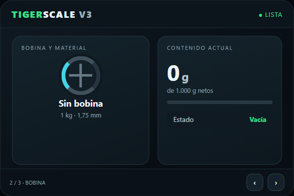
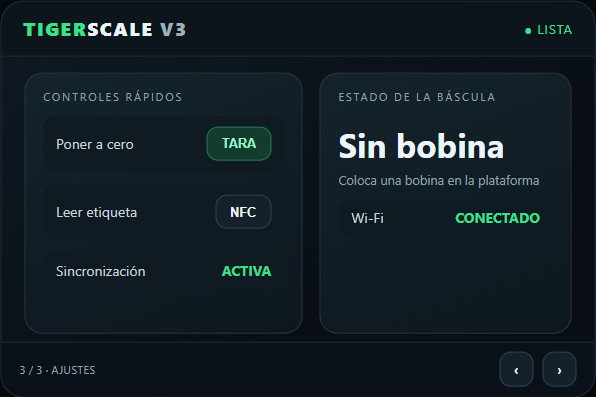

  <picture>
    <source media="(prefers-color-scheme: dark)" srcset="assets/logo-tigertag-head-dark.svg">
    <source media="(prefers-color-scheme: light)" srcset="assets/logo-tigertag-head.svg">
    
  </picture>

<h1 align="center">TigerScale V3 · Español</h1>

<strong>Una báscula conectada que reconoce la bobina de filamento.</strong> 
Pantalla táctil, dos lectores NFC y seguimiento del material restante con el estándar abierto TigerTag.

  
  
  
  

**Este fork conserva el proyecto original y sus funciones, pero inicia en español.** El firmware ya incluye traducciones a once idiomas; también se ha cambiado el idioma inicial de la pantalla y la web a español. El selector permite cambiarlo y la elección queda guardada.

> TigerScale V3 no es TigerPOD: son proyectos distintos y no ofrecen las mismas funciones.

## Qué hace

Coloca en la plataforma una bobina con etiqueta NFC TigerTag. La báscula identifica el material, mide el peso, descuenta el peso del carrete vacío y calcula cuánto filamento queda. Si se configura la cuenta, también sincroniza la información con TigerTag. La lectura y el pesaje locales funcionan sin conexión a Internet.

## Fotos y pantallas

La foto muestra el dispositivo montado. Las tres capturas siguientes son una **previsualización simulada en PC** de las páginas de báscula, bobina y ajustes; no son fotografías de una placa física ni ejecutan el firmware.

  

  
  
  

## Hardware

La versión V3 está diseñada para la placa **Waveshare ESP32-S3-Touch-LCD-3.5B** o **ESP32-S3-Touch-LCD-3.5**, con pantalla táctil de 3,5 pulgadas, dos lectores PN532, célula de carga de 5 kg y amplificador HX711. Las dos variantes de placa requieren compilaciones distintas; comprueba la serigrafía antes de instalar el firmware.

La caja imprimible, la lista completa de componentes, los pines y el cableado están documentados en [docs/HARDWARE.md](docs/HARDWARE.md). El montaje también requiere tornillería específica para la célula de carga y la pantalla; consulta las fotografías del documento antes de comprar o ensamblar.

## Instalación rápida

1. Conecta la placa al PC mediante USB.
2. Abre el [instalador web oficial](https://tigertag-project.github.io/Tiger-Scale-V3/) en un navegador compatible con Web Serial.
3. Selecciona la variante exacta de placa y sigue los pasos que muestra el instalador.
4. Enciende la báscula, elige el idioma y calibra la célula de carga antes de pesar bobinas.

También puedes compilar desde el código con PlatformIO. La guía completa en español está en [docs/INSTALLATION.md](docs/INSTALLATION.md).

## Simulación en ESP32 Simulador

Este repositorio incluye un perfil para probar una **maqueta interactiva** en el programa ESP32 Simulador. Copia `outputs/ESP32Simulador/perfiles/tigerscale_v3.sim.json` a la carpeta `perfiles` junto al ejecutable del simulador. Selecciona **TigerScale V3 · español**, pulsa **Play** y elige escenarios como etiqueta leída, pesaje o falta de conexión.

La maqueta reproduce una pantalla rectangular de 480 × 320 y permite cambiar de página, aplicar tara simulada y ver estados de NFC y sincronización. Utiliza datos ficticios: no ejecuta el firmware, no conecta con la báscula y no sustituye una prueba en la placa real.

## Funciones principales

- Identificación de bobinas TigerTag mediante NFC.
- Peso bruto y cálculo del filamento restante.
- Cero/tara y calibración de la báscula.
- Funcionamiento local aunque no haya conexión de red.
- Sincronización de cuenta y API local, configurables.
- Interfaz en once idiomas, con español como idioma inicial en este fork.
- Dos variantes de placa con sus compilaciones correspondientes.

## Documentación

- [Guía de instalación](docs/INSTALACION_ES.md)
- [Puerto serie y controladores](docs/PUERTO-SERIE_ES.md)
- [Resolución de problemas](docs/RESOLUCION-PROBLEMAS_ES.md)
- [Hardware, pines y montaje](docs/HARDWARE.md)
- [Sincronización en la nube y privacidad](docs/CLOUD.md)
- [Referencia completa de la API](docs/API.md)
- [Telemetría y datos enviados a la nube](docs/TELEMETRY.md)
- [Firmware y arquitectura](docs/FIRMWARE.md)
- [Vincular una cuenta TigerTag](docs/ACCOUNT-PAIRING.md)
- [Guía para MakerWorld](docs/MAKERWORLD.md)
- [Rendimiento RFID](docs/RFID-PERFORMANCE.md)
- [Informe sobre USB Host y NFC](docs/USB_HOST_POSTMORTEM.md)
- [Historial de revisiones](docs/reviews/README.md)
- [Criterios para las revisiones técnicas](docs/REVIEW-BRIEF.md)
- [Novedades](WHATSNEW.md)
- [Registro de cambios](CHANGELOG.md)
- [Contribuir al proyecto](CONTRIBUTING.md)
- [Política de seguridad](SECURITY.md)
- [Código de conducta](CODE_OF_CONDUCT.md)
- [Marcas y uso del nombre](TRADEMARK_ES.md)
- [Licencias de terceros](THIRD_PARTY_LICENSES_ES.md)
- [Guía de agentes de código](AGENTS_ES.md)
- [Guía de Claude Code](CLAUDE_ES.md)
- [Mapa detallado del repositorio](CODEMAP_ES.md)
- [Registro de trabajo](WORKLOG_ES.md)
- [Notas de versión v3.13.0](docs/release-notes/v3.13.0.md)
- [Notas de versión v3.12.0](docs/release-notes/v3.12.0.md)
- [Notas de versión v3.11.0](docs/release-notes/v3.11.0.md)
- [Notas de versión v3.10.0](docs/release-notes/v3.10.0.md)
- [Notas de versión v3.9.0](docs/release-notes/v3.9.0.md)
- [Notas de versión v3.8.1](docs/release-notes/v3.8.1.md)
- [Notas de versión v3.8.0](docs/release-notes/v3.8.0.md)
- [Notas de versión v3.7.6](docs/release-notes/v3.7.6.md)
- [Notas de versión v3.7.5](docs/release-notes/v3.7.5.md)
- [Notas de versión v3.7.4](docs/release-notes/v3.7.4.md)
- [Notas de versión v3.7.3](docs/release-notes/v3.7.3.md)
- [Notas de versión v3.7.2](docs/release-notes/v3.7.2.md)
- [Notas de versión v3.7.1](docs/release-notes/v3.7.1.md)
- [Notas de versión v3.7.0](docs/release-notes/v3.7.0.md)
- [Notas de versión v3.6.0](docs/release-notes/v3.6.0.md)
- [Notas de versión v3.5.0](docs/release-notes/v3.5.0.md)
- [Notas de versión v3.4.0](docs/release-notes/v3.4.0.md)
- [Notas de versión v3.3.0](docs/release-notes/v3.3.0.md)
- [Notas de versión v3.2.0](docs/release-notes/v3.2.0.md)
- [Notas de versión v3.1.3](docs/release-notes/v3.1.3.md)
- [Notas de versión v3.1.2](docs/release-notes/v3.1.2.md)
- [Notas de versión v3.1.1](docs/release-notes/v3.1.1.md)
- [Notas de versión v3.1.0](docs/release-notes/v3.1.0.md)
- [Notas de versión v3.0.0](docs/release-notes/v3.0.0.md)
- [README original en inglés](README.en.md)

## Compilar y verificar

Necesitas Git, Python, PlatformIO y las dependencias que declara `platformio.ini`. Para revisar el repositorio ejecuta `bash scripts/verify.sh --quick`; para compilar las variantes, consulta los entornos disponibles en `platformio.ini` y la guía de instalación.

La simulación del PC solo valida la maqueta y la navegación. No confirma el funcionamiento de los lectores NFC, la célula de carga, el Wi-Fi ni la pantalla física.

## Licencia y créditos

El firmware se distribuye bajo la licencia MIT. Consulta [LICENSE](LICENSE), la [guía de licencias de terceros](THIRD_PARTY_LICENSES_ES.md) y la [guía de marcas](TRADEMARK_ES.md). Se conservan intactos los avisos legales originales.

Para colaborar, consulta [CONTRIBUTING.md](CONTRIBUTING.md) y el [código de conducta](CODE_OF_CONDUCT.md). Este fork mantiene el código original y añade la selección inicial en español y el perfil independiente de simulación.
